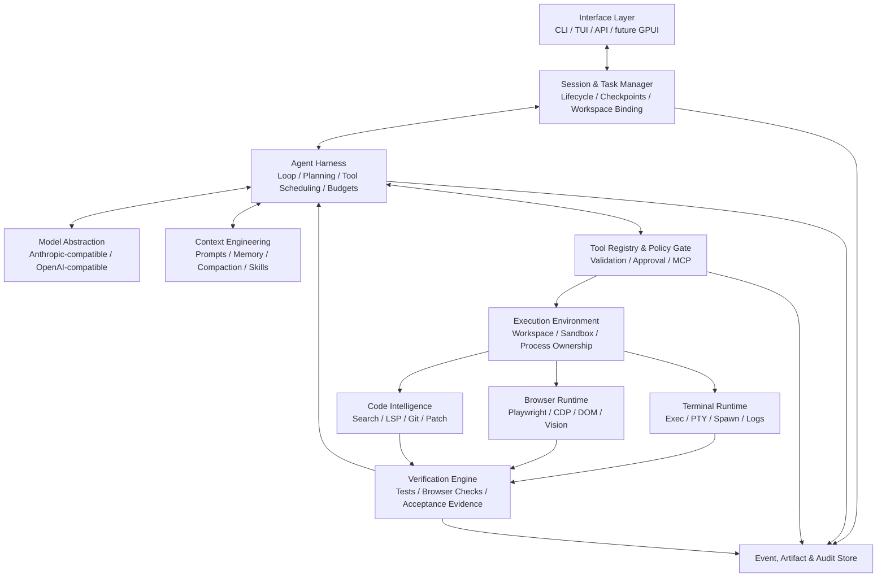
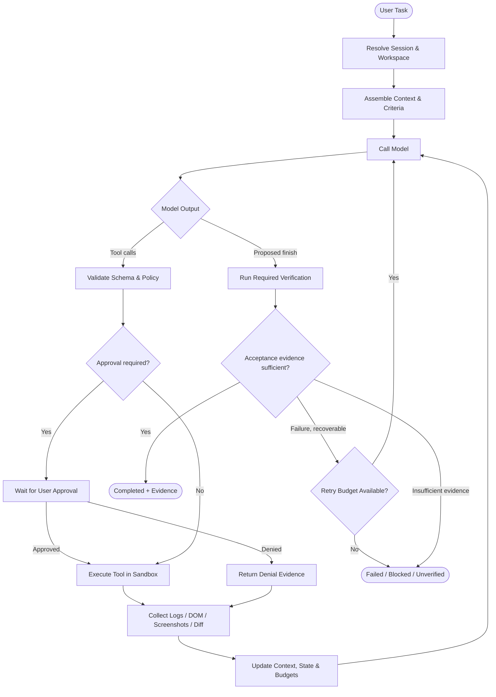
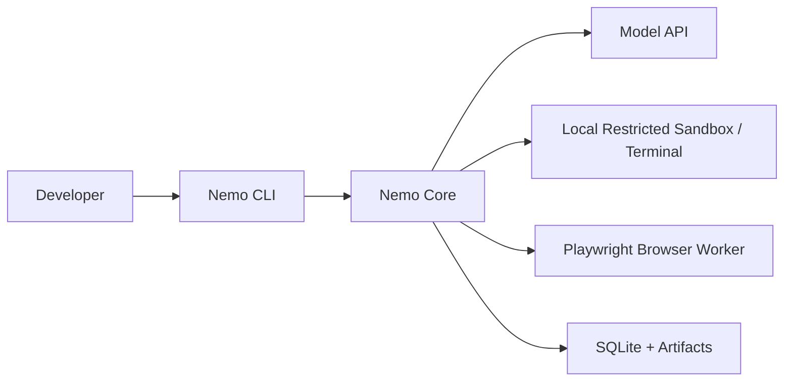
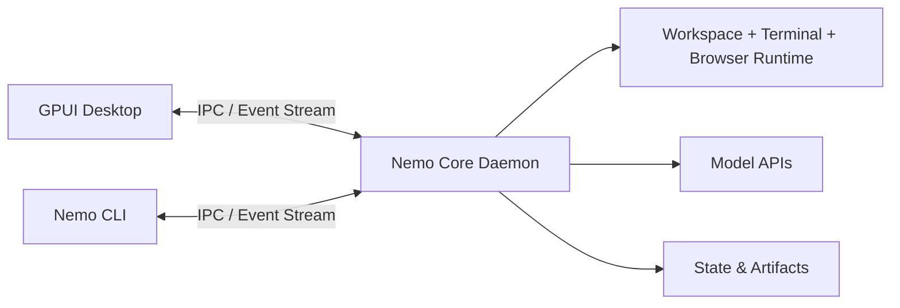

# Nemo — Solution Concept & Technical Design

> **Document status:** Proposed architecture · **Version:** 1.1 · **Date:** 2026-10-26  
> **Product:** Nemo — Model-Agnostic Autonomous Coding Agent  
> **Audience:** Product engineering, agent-runtime engineers, platform engineers, security and QA.

### Revision history

| Version | Date | Change |
|---|---|---|
| 1.0 | 2026-10-26 | Initial proposed architecture |
| 1.1 | 2026-10-26 | Core engine mandated in Rust; existing Node.js CLI becomes the frozen reference implementation; roadmap, risks, ADRs and appendices updated |

---

## 1. Executive Summary

**Nemo** is a standalone, model-agnostic autonomous coding agent designed to understand software projects, modify source code, execute commands, operate a browser, diagnose failures and independently verify outcomes within explicit permission and resource boundaries.

Nemo **owns its agent loop and tool runtime**. Its existing Node.js CLI was built by adapting a Claude CLI-inspired implementation and is now being migrated to Rust (see ADR-010); it is **not a wrapper or subprocess orchestrator for Claude Code or Codex CLI**. Models are consumed directly through **Anthropic-compatible** and **OpenAI-compatible** APIs.

The proposed strategy is **CLI-first, headless-capable, runtime-centered**, with a **core engine implemented in Rust (mandatory)**. The existing Node.js CLI (`~/Vibe/nemo-cli`, roughly 24k lines of JavaScript) becomes the **frozen reference implementation** (the "oracle": bug fixes, CI and tests only, no new autonomous features) until the Rust cutover. New code lives in `~/Vibe/Coding-Agent/nemo-cli` as a Cargo workspace and is delivered by a strangler migration. The core stays independent from any UI. A future GPUI desktop client can show live browser, terminal, diffs and agent traces without becoming a runtime dependency.

### 1.1 Design outcomes

1. Complete the loop: **Understand → Plan → Act → Observe → Diagnose → Fix → Verify**.
2. Use terminal, browser, files and Git within one session-scoped execution environment.
3. Allow compatible models to use normalized tools while respecting their actual capabilities.
4. Persist sessions, isolate workspaces and support interruption, resumption and auditability.
5. Determine task completion using explicit acceptance criteria and observed evidence, not only model assertions.
6. Keep operations governed by permissions, sandboxing, resource budgets and human approvals.
7. Ship a single native, cross-OS binary (macOS/Linux/Windows) with no Node runtime required for the core.

### 1.2 Non-goals for the initial release

- Reimplementing Claude Code or Codex provider harnesses as external dependencies.
- Full autonomous access to the host machine, arbitrary secrets or production systems.
- A mandatory GPUI interface or embedded browser engine.
- Complex multi-agent collaboration before single-agent reliability is established.
- Perfect formal proof of software correctness; Nemo reports what was actually checked.

---

## 2. Product Concept

### 2.1 Problem

Most coding chat workflows stop after producing a patch or command. The human must still launch the application, inspect failures, use browser developer tools, iterate on the code and assess whether the outcome is correct. Nemo closes that feedback loop by placing development tools and verification within the agent's execution environment.

### 2.2 Value proposition

| Capability | Nemo behavior | User benefit |
|---|---|---|
| Codebase understanding | Reads targeted files, searches symbols, inspects Git and diagnostics | Less manual repository explanation |
| Code execution | Executes shell commands, runs tests and manages long-running servers | End-to-end task execution |
| Browser interaction | Inspects DOM/accessibility, clicks/types, captures screenshots, reads console/network | Real frontend validation |
| Self-correction | Correlates observations, changes code, reruns relevant checks | Fewer manual debug loops |
| Session durability | Saves execution history, task state and scoped resources | Resume and audit |
| Model portability | Uses Anthropic-compatible or OpenAI-compatible backends | Provider flexibility |
| Controlled autonomy | Applies approval, sandbox and budgets to tool operations | Safer unattended work |

### 2.3 Primary user journeys

**Journey A — Fix frontend issue:** User describes a broken login. Nemo finds the implementation, starts the development server, uses a browser to reproduce the defect, records console/network and server logs, patches the bug, reruns the test flow, and returns a diff plus evidence.

**Journey B — Implement a feature:** Nemo decomposes an acceptance criterion into edits and checks, modifies implementation and tests, runs build/lint/test, and reports remaining unverified behavior.

**Journey C — Debug backend:** Nemo starts services and a focused test command, correlates process output with source code, patches the cause, verifies regressions and explains the result.

### 2.4 Product principles

- **Autonomy with evidence:** Don't equate a successful tool call with a successful task.
- **Runtime first, UI second:** CLI/TUI, API and future GPUI share one core.
- **Session ownership:** Every tool action resolves through the current session and workspace.
- **Least privilege:** Untrusted repository files, terminal output and browser content cannot grant permissions.
- **Explicit capability negotiation:** An “OpenAI-compatible” endpoint may not support every modality, reasoning format or parallel tool call.
- **Recoverable execution:** Structured events, artifacts and checkpoints matter more than transcript-only persistence.
- **Human control:** Stop, approve, inspect, retry and revert at predictable boundaries.

---

## 3. Requirements and Scope

### 3.1 Functional requirements

| ID | Requirement | Priority |
|---|---|---|
| FR-01 | Native interactive CLI/TUI with streaming model output and tool events | P0 |
| FR-02 | Direct Anthropic-compatible and OpenAI-compatible model adapters | P0 |
| FR-03 | Autonomous agent loop with tool calls, pause, stop and retry | P0 |
| FR-04 | Read/write/patch/search files scoped to workspace | P0 |
| FR-05 | Short shell execution and managed long-running processes | P0 |
| FR-06 | Browser automation, screenshot, DOM, console and network inspection | P0 |
| FR-07 | Acceptance criteria, test execution and self-correction loop | P0 |
| FR-08 | Permissions, approval prompts, tool budgets and trace logs | P0 |
| FR-09 | Persistent sessions with attach/resume and durable metadata | P1 |
| FR-10 | Git worktree and process/browser isolation per concurrent session | P1 |
| FR-11 | LSP/symbol diagnostics and intelligent code navigation | P1 |
| FR-12 | Desktop GPUI as an optional thin client | P2 |
| FR-13 | Remote execution and multi-agent task orchestration | P2 |

### 3.2 Non-functional requirements

- **Correctness:** Tool side effects and completion claims must be attributable to observable actions.
- **Isolation:** Each session has an explicit workspace root, cwd, process registry and browser context.
- **Portability:** Core usable without GUI on developer machines, remote hosts and CI, delivered as a native Rust binary for macOS, Linux and Windows.
- **Resilience:** Cancellation and crash recovery handle interrupted process/tool actions safely.
- **Security:** Strong sandbox policies, using OS sandbox primitives where available (candidates in §5.7); protected secrets, path boundaries, network rules, approval gates.
- **Observability:** Event and artifact correlation by task/session/turn/tool IDs.
- **Extensibility:** Providers, tools and runtime backends can be replaced behind Rust traits or process-level RPC interfaces.
- **Efficiency:** Bounded token usage, output truncation, incremental logs and context compaction.

---

## 4. Logical Architecture



**Key separation:** The agent harness makes decisions; tools perform actions only after policy validation; runtime backends own real resources. The UI observes and controls execution but does not own it.

### 4.1 The 12 logical components

| # | Component | Responsibilities | Initial status |
|---|---|---|---|
| 01 | Interface Layer | CLI/TUI, streaming, approvals; later GPUI/API | TUI: port to Rust (ratatui/crossterm, faithful); headless JSONL: new |
| 02 | Session & Task Manager | Sessions, task states, lifecycle, persistence, resume | New in Rust (SQLite, `WorkspaceContext`); reads existing transcript formats |
| 03 | Agent Harness | Model turns, tool loop, planning, retry, stopping rules | Port + reshape (typed events replace EventEmitter) |
| 04 | Model Abstraction | Providers, model capabilities, streaming, schema normalization | Port + conformance tests |
| 05 | Context Engineering | System/project instructions, history, memory, compaction, skills | Port + extend |
| 06 | Tool System | Registry, dispatch, permissions, MCP adapters, validation | Port + extend (`git.*`, `verify.run`, `artifact.read`, `browser.*`) |
| 07 | Execution Environment | Workspace, sandbox, resource ownership, isolation | New (no OS sandbox exists in Node) |
| 08 | Terminal Runtime | Shell/PTY/process manager/logs | New `TerminalRuntime` (not a 1:1 port of the Bash tool) |
| 09 | Browser Runtime | Automation, diagnostics, browser lifecycle | New |
| 10 | Code Intelligence | Git, search, patch, LSP diagnostics | Port search/edit; new git/LSP |
| 11 | Verification Engine | Test/check plans, evidence, self-correction gates | New |
| 12 | Observability & Security | Events, telemetry, secrets, policy, audits | New + port permissions (cross-cutting) |

---

## 5. Component Technical Design

### 5.1 Interface Layer

Interfaces are clients of the same session and event APIs.

- **CLI/TUI (P0):** interactive chat, prompt input, streaming results, tool output summaries, progress, approval and interrupt.
- **Headless command (P1):** submit a task, stream JSONL events, return exit codes and artifact paths.
- **Desktop GPUI (P2):** terminal view, browser preview, diff review, session timeline and approvals.
- **Remote API (P2):** create/attach/cancel sessions and subscribe to events; authenticated access.

**Contract:** A UI sends commands to the Session Manager and subscribes to event streams; the UI must not directly mutate runtime-owned process or browser state.

### 5.2 Session & Task Manager

**Entities:** `Session`, `Task`, `WorkspaceContext`, `Turn`, `ToolInvocation`, `Artifact`, `Checkpoint`.

Suggested states:

```text
created -> preparing -> running -> verifying -> completed
                         |       |          |
                         v       v          v
                  waiting_approval       unverified
                         |                  |
                         v                  v
                       running          blocked/failed

running -> cancelling -> cancelled
running -> interrupted -> recovering -> running/blocked
```

Each session owns or references:

- `session_id`, `task_id`, `model_config_id`, `created_at`, `status`.
- `workspace_id`, immutable `workspace_root`, `working_directory`, `git_worktree_path`.
- `process_group_id`, `browser_context_id`, port reservations and artifact root.
- `permission_policy_id`, budget counters, event cursor and checkpoint pointer.

**Invariant:** A new session **must not inherit the previous session's working directory implicitly**. Determine the cwd from an explicit workspace selection or a documented default and persist it on creation. Tool requests must resolve paths relative to that session context.

### 5.3 Agent Harness

The harness executes the model/tool feedback loop and enforces stop conditions.

**Responsibilities:**

1. Assemble context and call the selected provider.
2. Stream and normalize assistant response chunks, tool calls and provider errors.
3. Validate proposed tools against schemas, policies and current session state.
4. Dispatch approved tool invocations to the execution runtime.
5. Normalize and summarize tool outputs; append evidence to history.
6. Continue, pause, request approval or enter verification based on state.
7. Respect token/time/tool-call limits, cancellation and recovery procedures.

Avoid duplicating a second model-driven agent loop inside the browser or terminal runtime. Those are tool services; the harness remains the decision authority.

### 5.4 Model Abstraction Layer

Expose `ModelProvider` adapters for Anthropic-compatible and OpenAI-compatible endpoints.

**Provider capabilities (explicit or probed where safe):** `tools`, `parallel_tools`, `images`, `reasoning`, `streaming`, `structured_output`, `prompt_cache`, context window and max output.

**Normalization challenges:**

- Anthropic content blocks vs OpenAI-style message/tool-call structures.
- Streaming tool arguments arriving as deltas and requiring reconstruction/validation.
- Reasoning/thinking blocks with provider-specific constraints; never fabricate or leak hidden internals.
- API errors, rate limits, retries and idempotent replay behavior.
- Tool response IDs and multimodal payload sizing.
- Compatible endpoints with incomplete or nonstandard implementations.

Provider selection changes generation; it does not change the meaning or authority of tools.

### 5.5 Context Engineering & Memory

**Context assembly order:** active system rules → task-specific instructions → repository instructions → compact task state → relevant files/search snippets → recent tool evidence → conversation history within budget.

- Use progressive discovery for skills and external tools rather than injecting all schemas and instructions.
- Preserve stable task goals, constraints, file changes and outstanding checks across compaction.
- Distinguish durable task state from raw conversation text.
- Truncate very long logs and keep full output as a referenced artifact.
- Treat repository README, comments, webpages and tool outputs as untrusted task data, not governing instructions.

**Initial memory implementation:** structured local session store + project instruction files + task summaries. A vector index is optional, not required for MVP.

### 5.6 Tool System

A unified `ToolRegistry` exposes names, descriptions, schemas, permissions, side-effect classes and runtime bindings.

**Initial built-in tools:**

- `file.read`, `file.write`, `file.patch`, `file.search`
- `terminal.exec`, `terminal.spawn`, `terminal.logs`, `terminal.signal`
- `browser.navigate`, `browser.snapshot`, `browser.click`, `browser.fill`, `browser.screenshot`, `browser.console`, `browser.network`
- `git.status`, `git.diff`, `git.apply_patch`, `git.revert` (restricted)
- `verify.run` and `artifact.read`

**Execution pipeline:** schema validation → permission decision → workspace binding → resource/budget check → execution → result normalization → event/artifact persistence.

Use MCP adapters for extension, but don't make MCP a mandatory dependency of core terminal and browser interfaces.

### 5.7 Execution Environment & Workspace

Suggested abstractions:

- `WorkspaceManager`: create/open/close workspace and resolve paths safely.
- `WorktreeManager`: allocate branch/worktree per concurrent session, track merge/conflicts.
- `SandboxManager`: choose `local_restricted`, `container`, or `remote` backend.
- `ResourceManager`: own process groups, ports, browser contexts, temp directories and artifacts.

**Session isolation example:**

```text
session: nemo-s-42
workspace: /projects/nemo/worktrees/nemo-s-42
cwd:       /projects/nemo/worktrees/nemo-s-42
ports:     [43120, 43121]
processes: [dev-server-1, test-runner-1]
browser:   context-nemo-s-42
artifacts: ~/.nemo/sessions/nemo-s-42/artifacts/
```

A local restricted backend should enforce boundaries as far as the operating system supports. Candidate OS primitives, all to be verified before being relied upon: macOS Seatbelt; Linux Landlock and/or bubblewrap; Windows Job Objects/AppContainer (expected to give weaker guarantees than the other two). A stronger sandbox/container is necessary for untrusted code. Path checks alone do not constitute a secure sandbox. For worktree isolation, shared external services (database, caches, cloud resources) also require namespacing or explicit warnings.

### 5.8 Terminal & Process Runtime

Provide both *ephemeral* commands and *persistent* services:

```rust
#[async_trait]
pub trait TerminalRuntime: Send + Sync {
    async fn exec(&self, session_id: &SessionId, spec: ExecSpec) -> Result<ExecResult>;
    async fn spawn(&self, session_id: &SessionId, spec: SpawnSpec) -> Result<ProcessHandle>;
    async fn read_logs(&self, session_id: &SessionId, process_id: &str, cursor: Option<String>) -> Result<LogChunk>;
    async fn signal(&self, session_id: &SessionId, process_id: &str, signal: Signal) -> Result<()>;
    async fn get_status(&self, session_id: &SessionId, process_id: &str) -> Result<ProcessStatus>;
}

pub enum Signal { Int, Term, Kill }
```

Illustrative Rust, not ready to compile: async via tokio, types serde-derived.

Important implementation details:

- cwd and environment are taken from the session's `WorkspaceContext` unless explicitly overridden under policy.
- Bound output bytes, line counts and runtime; send full logs to artifact storage.
- Support readiness checks (HTTP/port/log pattern), not only successful process spawn.
- Terminate the process tree (not just parent PID) where supported.
- Handle TTY and non-TTY modes; propagate exit codes and cancellation accurately.
- A spawned dev server must survive a completed shell tool call and not outlive its authorized session lifecycle.

### 5.9 Browser Runtime

**Baseline implementation:** Playwright-based worker; Chrome DevTools Protocol (CDP) where supported. The browser runner can be a local subprocess/service controlled by Nemo.

**Backend under a Rust core:** Because the core is Rust, the backend is decided by a time-boxed spike at the start of the browser phase between (a) a Playwright worker run as a separate sidecar process behind a structured RPC (needs Node at runtime) and (b) direct CDP from Rust. Maturity of Rust CDP crates is unverified. Browser content remains untrusted data under either choice.

**Tools/capabilities:**

1. **Navigation:** launch, navigate, back/forward, tabs and redirects.
2. **DOM/accessibility:** role-based find, snapshot, selectors, form interactions.
3. **Screenshots/vision:** image capture, viewport and layout inspection, visual evidence.
4. **Diagnostics:** console logs, uncaught JS errors, failed requests, response status and timings.
5. **Artifacts:** trace, screenshots and optionally video; bounded retention.
6. **Session isolation:** separate browser context/profile/storage for each session.
7. **Safety:** domain/network restrictions, download limits, sensitive-input redaction, explicit approval for externally impactful actions.

**Preferred interaction sequence:** DOM/accessibility first for reliability → screenshots when visuals matter → diagnostic logs/network for root cause. Coordinate-based clicks are a fallback, not the default.

Do not embed Chromium into GPUI initially. The runtime can own a separate browser instance and stream screenshots/events to desktop UI later.

### 5.10 Code Intelligence & Git

Start with efficient primitives: `ripgrep`, file globbing, Git status/diff, patch operations and language-server diagnostics where useful. Add tree-sitter, symbol graphs or semantic indexes only after measuring retrieval gaps.

**Guardrails:** maintain a clean baseline, separate agent edits from user edits, show diffs, detect unexpected changes, and never silently reset user modifications.

### 5.11 Verification & Self-Correction Engine

**Inputs:** user acceptance criteria, task plan, changed files, runtime diagnostics and generated tests.

**Checks (when applicable):** syntax/typecheck, lint, unit/integration tests, build, browser E2E, HTTP checks and focused regression tests.

**Verification status:**

- `passed`: relevant criteria checked with evidence.
- `failed`: check executed and failed.
- `unverified`: no sufficient check or incomplete evidence.
- `blocked`: environment/credentials/dependency issue prevents verification.

Store `VerificationReport` with command, exit code, artifacts, tested criteria, limitations and timestamps. The harness can attempt bounded correction after failures. A pass in one test suite is not proof that all behavior is correct; report scope precisely.

### 5.12 Observability, Policies & Security

**Event taxonomy:** `session.started`, `turn.started`, `model.delta`, `tool.requested`, `tool.approval_required`, `tool.started`, `tool.completed`, `artifact.created`, `verification.completed`, `session.completed`, `session.failed`, `session.cancelled`.

**Telemetry:** duration, token counts, provider/model usage, tool latency, error rate, verification success, retries, resource footprint and per-task cost.

**Security controls:**

- Explicit permission classes: read-only; workspace-write; process/network; sensitive/external actions.
- Sandbox policy and network egress allowlist/denylist as required by threat model.
- Secret handling with masking and least-privileged environment injection.
- Approval before destructive Git operations, production changes, external submissions and risky shell commands.
- Prompt injection defenses: external content is data; it cannot redefine permissions or higher-priority task instructions.
- Time, token, subprocess, storage and outbound-network budgets.

---

## 6. Autonomous Execution Workflow



### 6.1 Worked example: frontend login defect

1. Create session and allocate isolated Git worktree.
2. Discover app commands (`package.json`, docs, scripts) and locate authentication components.
3. Start server through managed terminal process, wait for readiness.
4. Launch isolated browser context; navigate to login page.
5. Reproduce error via DOM-based steps; capture request failures, console, screenshot and server logs.
6. Identify likely cause using code, runtime and network evidence.
7. Patch code; execute focused test/build checks.
8. Reload browser and repeat the original flow; capture verification artifacts.
9. Report changed files, observed success/failure, tests run, screenshots/logs, and remaining uncertainty.
10. Cleanup or retain resources according to session policy.

### 6.2 Stop conditions

Stop or ask for input when: user cancels; approval is required but unavailable; repeated attempts make no progress; token/time/tool budget expires; workspace is unsafe; or verification is blocked by missing credentials/dependencies. Do not claim success solely because the model emitted a final message.

---

## 7. Runtime Contracts and Data Model

### 7.1 Core contracts (illustrative Rust)

```rust
pub type SessionId = String;
pub type TaskId = String;

#[derive(Serialize, Deserialize)]
#[serde(rename_all = "snake_case")]
pub enum SessionStatus {
    Created, Preparing, Running, WaitingApproval,
    Verifying, Completed, Unverified, Blocked,
    Failed, Cancelling, Cancelled, Interrupted,
}

#[derive(Serialize, Deserialize)]
pub struct WorkspaceContext {
    pub workspace_id: String,
    pub root: PathBuf,
    pub cwd: PathBuf,
    pub git_worktree: Option<PathBuf>,
    pub artifact_root: PathBuf,
    pub browser_context_id: Option<String>,
    pub process_group_id: String,
}

#[derive(Serialize, Deserialize)]
pub struct Budget {
    pub max_turns: u32,
    pub max_tool_calls: u32,
    pub max_cost_usd: Option<f64>,
}

#[derive(Serialize, Deserialize)]
pub struct AgentSession {
    pub id: SessionId,
    pub task_id: TaskId,
    pub status: SessionStatus,
    pub workspace: WorkspaceContext,
    pub model_config_id: String,
    pub permission_policy_id: String,
    pub event_cursor: u64,
    pub budget: Budget,
}

pub struct ToolContext {
    pub session_id: SessionId,
    pub workspace: WorkspaceContext,
    pub approval_token: Option<String>,
    pub cancel: tokio_util::sync::CancellationToken,
}

#[derive(Serialize, Deserialize)]
#[serde(rename_all = "snake_case")]
pub enum SideEffectClass { Read, Write, Execute, External }

#[async_trait]
pub trait ToolDefinition: Send + Sync {
    type Input: DeserializeOwned + Send;
    type Output: Serialize + Send;

    fn name(&self) -> &str;
    fn schema(&self) -> serde_json::Value;
    fn side_effect_class(&self) -> SideEffectClass;
    async fn execute(&self, input: Self::Input, ctx: &ToolContext) -> Result<Self::Output>;
}
```

**Important:** Treat interface examples as design contracts, not ready-to-compile production code. The core engine must be implemented in Rust (ADR-010). Allowed non-Rust components are limited to: a browser worker run as a separate process behind a structured RPC (for example a Playwright sidecar, which needs Node at runtime) if the browser spike chooses it; external MCP servers; skill scripts; and test/eval tooling.

### 7.2 Persistence schema (minimum)

| Entity | Minimum fields |
|---|---|
| `sessions` | `id`, `status`, `workspace_root`, `cwd`, `model_config`, `created_at`, `updated_at` |
| `tasks` | `id`, `session_id`, `request`, `acceptance_criteria`, `status` |
| `events` | `seq`, `session_id`, `turn_id`, `type`, `payload_ref`, `time` |
| `tool_calls` | `id`, `session_id`, `tool_name`, `input_ref`, `result_ref`, `status`, `duration` |
| `processes` | `id`, `session_id`, `pid/handle`, `cwd`, `started_at`, `status`, `log_cursor` |
| `browser_contexts` | `id`, `session_id`, `backend`, `profile_ref`, `status` |
| `artifacts` | `id`, `session_id`, `kind`, `path`, `size`, `retention_policy` |
| `verification_reports` | `id`, `task_id`, `status`, `checks`, `evidence_refs` |
| `approvals` | `id`, `session_id`, `tool_call_id`, `decision`, `reviewer`, `time` |

SQLite + local artifacts is sufficient for a single-machine MVP. Remote scale can later introduce centralized metadata storage and object artifacts without changing logical contracts.

### 7.3 Event streaming

Prefer typed, append-only event records with a monotonic per-session sequence number. Clients subscribe from a cursor and can reconnect without losing intermediate state. Avoid persisting raw secrets or massive binary payloads inline; store an artifact reference and redact sensitive fields.

---

## 8. Deployment Topologies

### 8.1 Local CLI (first milestone)



The CLI and core may initially be one process. Playwright/browser execution and managed terminal children should have explicit lifecycle and ownership.

### 8.2 Future desktop



GPUI and the CLI are both Rust and can share crates with the daemon. Whether the daemon runs separately or in-process remains an open decision (§13). A daemon is optional at the beginning, but useful for a GUI that can close/reopen without terminating sessions. Keep the wire protocol versioned and authenticated if it expands beyond local IPC.

### 8.3 Future remote execution

The Session Manager can route a session to a remote worker running the same tool-runtime contracts. This requires authenticated channels, resource quotas, artifact sync, cancellation, durable worker ownership and an explicit trust model. It should not be assumed to work by merely forwarding arbitrary shell commands over SSH.

---

## 9. Key Architecture Decisions (ADRs)

| ADR | Decision | Rationale / tradeoff |
|---|---|---|
| ADR-001 | Own agent harness and direct model API integration (implemented in Rust per ADR-010) | Preserves product independence; requires investment in provider compatibility |
| ADR-002 | CLI-first with UI-independent core | Reuses current work as reference implementation (oracle) and test corpus; supports headless workflows |
| ADR-003 | Use Playwright as first browser backend | Mature DOM and diagnostics; introduce a custom browser protocol only when needed. Under the Rust core, the integration (sidecar over RPC vs direct CDP) is decided by a spike |
| ADR-004 | Separate ephemeral commands from managed terminal processes | Enables dev servers, log collection and reliable lifecycle |
| ADR-005 | Session-scoped workspace and resource ownership | Prevents cross-session cwd/process/browser confusion |
| ADR-006 | Verification evidence is a first-class object | Reduces unsupported success claims |
| ADR-007 | Policy gate sits before tool execution | Model proposals do not grant privileges |
| ADR-008 | Defer GPUI to thin client phase | UI should not block autonomous runtime development; GPUI is Rust and may share crates with the core |
| ADR-009 | Defer complex multi-agent orchestration | Single-agent success and safety are foundational |
| ADR-010 | Core engine is implemented in Rust; Node CLI is a frozen reference until cutover | Native cross-OS binary without Node runtime, access to OS sandbox primitives, crates shareable with GPUI. Cost: rewrite effort, unverified crate maturity, a dual-maintenance window while both implementations exist |
| ADR-011 | Model access uses API keys only; no subscription/OAuth login flows | Anthropic and OpenAI do not permit third-party coding agents to authenticate through consumer subscriptions; API keys are the supported path (the Node CLI already works this way). Users manage their own keys through `NEMO_*` environment variables (no other env prefix is ever read) or provider config substitution; Nemo does not store credentials in a keychain and does not write them to disk. Bearer-style keys for Anthropic-compatible gateways remain API keys. Cost: users need billed API access and handle key hygiene themselves; no subscription-priced usage |

---

## 10. Delivery Roadmap

Indicative effort is about 9-11 months for one engineer (low confidence).

### Phase 0 — Reference baseline & contracts

**Deliverables:** Node reference green with CI on 3 OS; contract specs (event JSONL schema, `WorkspaceContext`, tool schema, session format); language-agnostic eval suite (black-box over the headless JSONL CLI); golden fixtures; Cargo workspace initialized in `~/Vibe/Coding-Agent/nemo-cli`.

**Exit criteria:** Node baseline eval results recorded per model; golden fixtures reviewed; workspace builds in CI.

### Phase 1 — Rust Core Engine (P0)

**Deliverables (headless first):** core lib, config, permissions, tools and the new `TerminalRuntime`; providers and MCP; harness, Verification Engine and typed events; then the TUI.

**Exit criteria:** complete a task headless end-to-end in Rust with eval >= baseline.

### Phase 2 — Autonomous Core (P0)

**Deliverables:** Browser Runtime; policy engine and OS sandbox; budgets; bounded retries and evidence-rich task reports.

**Exit criteria:** Nemo can autonomously reproduce and fix at least a defined set of frontend/backend bugs in controlled test projects, demonstrate commands and browser checks, and stop safely on approval/budget limits.

### Phase 3 — Durable & Isolated Execution and Cutover (P1)

**Deliverables:** SQLite sessions; explicit cwd/worktree binding; checkpoints and resume; process/browser ownership; daemon; event replay. Cutover work: cross-compile for 6 targets, signing/notarization, npm platform packages or installers, parallel run, retire Node.

**Exit criteria:** concurrent sessions operate on isolated worktrees and browser contexts, can reconnect, and do not execute commands in another session's directory. Cutover gates:

- Rust eval >= Node baseline on the same models.
- Golden tests green on macOS, Linux and Windows CI.
- Open audit items (ConPTY, clipboard, Git Bash quoting) verified on real runs.
- Session and config formats read/write compatible both ways during the parallel run.

### Phase 4 — GPUI Desktop (P2)

**Deliverables:** session navigator, terminal/browser preview, diff/approval UI, event timeline and reconnect to headless core; may share crates with the core.

**Exit criteria:** UI close/reopen does not corrupt or implicitly cancel daemon-owned tasks; approvals and artifact playback reflect authoritative runtime state.

### Phase 5 — Advanced Autonomy (P2)

**Deliverables:** parent/subagent task delegation, remote worker adapters, native desktop computer-use adapter and expanded evaluation benchmark.

**Exit criteria:** demonstrable performance improvements against a single-agent baseline, with controlled extra cost and reliable conflict handling.

---

## 11. Acceptance Tests and Metrics

### 11.1 Essential acceptance scenarios

| Scenario | Expected outcome |
|---|---|
| Frontend broken form | Reproduces via browser; patches; verifies DOM/action and relevant tests |
| Backend failing unit test | Runs targeted test, diagnoses logs, patches, reruns |
| Long-running dev server | Spawn returns handle; logs stream; readiness and termination work |
| Two concurrent sessions | Distinct cwd/worktrees/browser profiles/process scopes |
| Approval-gated command | Never executes before approval; denial recorded |
| Interrupted session | Recoverable task state or clear blocked status; no orphan resources |
| Missing credentials | Returns blocked with reason, not fabricated success |
| Model without vision | Degrades gracefully to DOM/text tools or reports limitation |
| Failed final verification | Reports failed/unverified and bounded self-correction attempt |
| Prompt injection in web content | External page text cannot override Nemo permission policy |

### 11.2 Quality metrics

- **Task success rate:** percentage of tasks meeting explicit acceptance criteria.
- **Verified completion rate:** percentage of success claims backed by checks.
- **Autonomous recovery rate:** failures corrected without user intervention.
- **Regression rate:** previously passing checks broken by changes.
- **Tool reliability:** failed/cancelled tool executions and leaked resources.
- **Efficiency:** time to verified result, tokens, tool calls and cost per task.
- **Safety:** blocked risky actions, approval compliance, cross-session isolation incidents.

A small fixed benchmark of representative repositories and deterministic defects should exist before major orchestration changes. Track baseline by model/provider, since model capabilities can dominate aggregate outcomes.

---

## 12. Risks and Mitigations

| Risk | Impact | Mitigation |
|---|---|---|
| Provider API differences | Broken tool calls or streaming | Capability registry, conformance tests, strict adapters |
| Model hallucinated success | False completion | Evidence-based verification and `unverified` status |
| Untrusted code execution | Host compromise/data leakage | Sandboxes, permission gate, network/secret isolation |
| Browser prompt injection | Unauthorized actions | Treat page content as data; enforced tool policy |
| Concurrent session collisions | Corrupted edits/processes | Per-session worktree, cwd, processes, browser profiles and ports |
| Infinite repair loops | Cost/time waste | Budgets, progress checks, retry ceilings |
| Log/context overload | Cost and degraded reasoning | Summaries, bounded output, artifact references |
| GUI/core coupling | Unstable headless operation | Core-owned resources and event-based thin UI |
| Worktree conflicts | Lost changes | Baseline tracking, diff, conflict detection, explicit merge |
| Fragile browser selectors | Flaky verification | Accessibility-first selectors, readiness waits, traces |
| Dual build (reshape + port) overruns | Schedule slip | Port only golden-tested modules faithfully; reshape only the named new contracts; track scope per phase |
| Rust crate immaturity (MCP/provider SDKs unverified) | Blocked or costly integrations | Early spikes in Phase 1; thin adapters behind traits; fall back to own minimal implementation |
| Node/Rust behavior drift during parallel run | Regressions, incompatible formats | Frozen Node reference, golden tests, shared eval suite, two-way format compatibility checks |
| Long period without autonomous features | Lost momentum | Dogfood the headless Rust loop before the TUI |

---

## 13. Open Design Decisions

These decisions should be validated against the existing Nemo implementation rather than assumed:

**Resolved:** Implementation language: the core engine is Rust (ADR-010).

1. **Process architecture:** in-process CLI, local daemon, or hybrid for session durability?
2. **Sandbox strength:** local restricted environment vs containers/VMs on supported platforms?
3. **Browser worker:** in-process driver vs dedicated process exposing structured RPC?
4. **Session store:** SQLite schema and durability policy; checkpoints vs event replay?
5. **Provider surface:** exact Anthropic/OpenAI-compatible API variants, auth, reasoning and multimodal support?
6. **Permission defaults:** which commands, paths, domains and external interactions need confirmation?
7. **Verification policy:** user-defined acceptance criteria vs inferred checks for each task type?
8. **Cross-platform strategy:** macOS first vs equivalent Windows/Linux feature completeness?
9. **Browser backend under Rust:** Playwright sidecar vs direct CDP (time-boxed spike).
10. **Windows sandbox level:** what guarantees are achievable with Job Objects/AppContainer?
11. **Daemon vs in-process:** shared crates make both feasible; decide by session-durability needs.

---

## 14. Recommended Immediate Implementation Plan

Completed input: **audit of existing CLI modules mapped to the 12 logical components** (see Appendix C).

- **R0 — Node foundation:** Node reference green with CI on 3 OS.
- **R1 — Contracts & eval:** event JSONL schema, `WorkspaceContext`, tool schema, session format, golden fixtures, eval suite, Cargo workspace.
- **R2 — Core lib:** config, permissions, tools and the new `TerminalRuntime`.
- **R3 — Providers + MCP.**
- **R4 — Harness + Verification Engine + headless CLI.**
- **R5 — TUI.**
- **R6 — Browser Runtime** (after the backend spike).
- **R7 — Policy + sandbox** (in parallel with R6).
- **R8 — Durable sessions, worktrees, daemon.**
- **R9 — Cutover** (gates in §10 Phase 3).

---

## Appendix A — Suggested Repository Modules

Location: `~/Vibe/Coding-Agent/nemo-cli`, organized as a Cargo workspace.

```text
nemo-cli/
├── apps/
│   ├── cli/
│   ├── desktop-gpui/           # Future GPUI
│   └── server/                 # Future API
├── crates/
│   ├── nemo-core/
│   ├── nemo-session/
│   ├── nemo-context/
│   ├── nemo-verification/
│   ├── nemo-events/
│   ├── nemo-providers/
│   ├── nemo-tools/
│   ├── nemo-policy/
│   ├── nemo-runtime-workspace/
│   ├── nemo-runtime-sandbox/
│   ├── nemo-runtime-terminal/
│   ├── nemo-runtime-browser/
│   ├── nemo-intel-search/
│   ├── nemo-intel-lsp/
│   ├── nemo-intel-git/
│   ├── nemo-storage/
│   ├── nemo-telemetry/
│   └── nemo-secrets/
└── tests/
    ├── unit/
    ├── integration/
    ├── e2e/
    ├── agent-evals/
    └── golden/
```

**Candidate crates (unverified):** ratatui, crossterm, tokio, reqwest, serde, clap, notify, rmcp, async-openai, schemars. These are candidates only; maturity and fit must be verified by spikes.

## Appendix B — Definitions

- **Agent Harness:** Loop that calls the model, decides/dispatches tool actions and manages state.
- **Provider Adapter:** Translating layer between Nemo's internal model contract and an API dialect.
- **Tool Runtime:** Code that performs shell, browser, filesystem or other real-world actions.
- **Workspace Context:** Explicit roots and ownership references for a session's resources.
- **Verification Evidence:** Check result with commands, logs, screenshots, tests and scope.
- **GPUI:** Rust-native graphics/UI framework suitable for an optional desktop client.
- **MCP:** Model Context Protocol; extension mechanism for integrating external tools.
- **CDP:** Chrome DevTools Protocol; browser control and diagnostic protocol.
- **Reference implementation (oracle):** The frozen Node.js CLI, used as the behavioral baseline (bug fixes, CI and tests only) until the Rust cutover.
- **Golden test:** A test comparing output against a recorded, reviewed expected result, used to prove faithful ports (config, permissions, parser, render).
- **Cutover:** The point at which the Rust binary replaces the Node CLI, after the gates in §10 Phase 3 are met.
- **Sidecar:** A separate helper process (for example a Playwright browser worker) controlled by the core over a structured RPC.

## Appendix C — Current-State Mapping (existing Node modules)

Based on a static survey and keyword grep; parts are unverified (stop conditions/budgets, provider capability registry, untrusted-content handling).

| # | Component | Existing Node modules / state |
|---|---|---|
| 01 | Interface Layer | `app.js`, `render.js`, `agentview.js` (TUI) |
| 02 | Session & Task Manager | `resume.js`, `opentabs.js` + `~/.claude/projects` JSONL; no SQLite |
| 03 | Agent Harness | `src/native/agent.js` |
| 04 | Model Abstraction | `providers/anthropic.js`, `openai.js`, modelnorm, routing |
| 05 | Context Engineering | compact, mentions, claudecfg, skills |
| 06 | Tool System | 20 tools in `src/native/tools` + `permissions.js` + `mcp.js` + hooks |
| 07 | Execution Environment | Permission layer only; no OS sandbox, no worktree |
| 08 | Terminal Runtime | Bash background + BashOutput/KillShell + shared `killTree` |
| 09 | Browser Runtime | None (WebFetch/WebSearch only) |
| 10 | Code Intelligence | Glob/Grep/Read/Edit; no git tool, no LSP |
| 11 | Verification Engine | None |
| 12 | Observability & Security | usage/stats token counting, hook events |

---

**Architecture conclusion:** Nemo should evolve from an existing independent Node.js CLI agent, kept as the frozen reference, into a controlled, Rust-core autonomous development runtime. Browser and terminal capabilities enable action; context and model orchestration enable decisions; verification turns actions into trustworthy results; a future GPUI is an observational and supervisory interface, not the foundation of autonomy.
